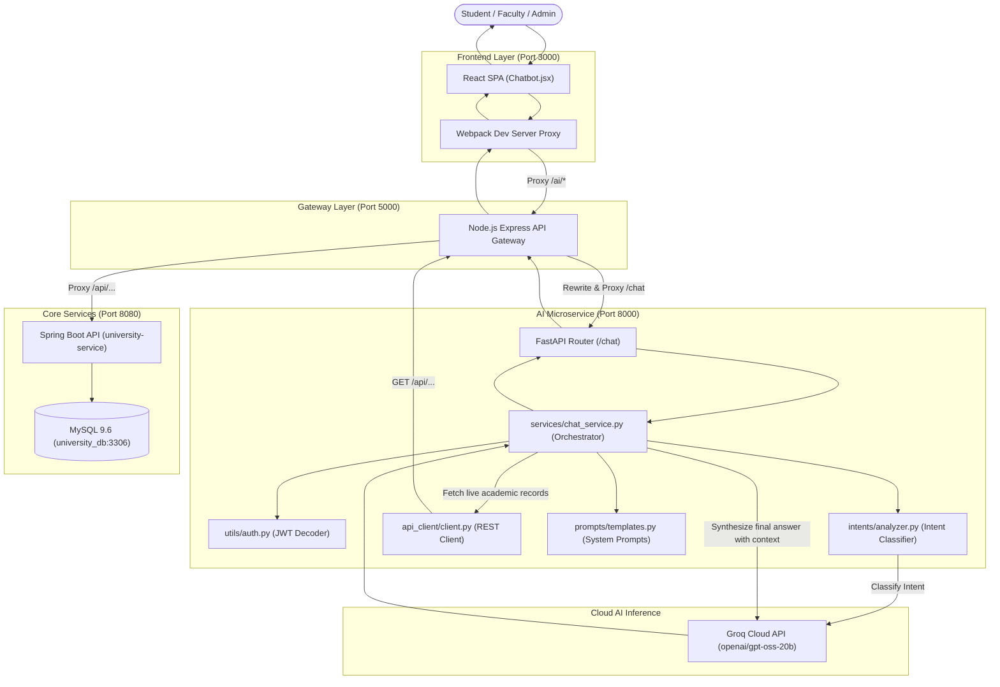

# University Management System - AI Service Architecture & Request Flow

This document details the internal folder structure of the **AI Microservice (`university-ai-service`)** and explains the complete step-by-step communication flow from the React frontend to the backend services and Groq LLM.

---

## 1. Complete System Architecture & Network Map



---

## 2. `university-ai-service` Folder Structure

Below is the directory layout of the Python AI microservice:

```
university-ai-service/
│
├── api_client/
│   ├── __init__.py
│   └── client.py             # HTTP client making authenticated REST requests to Spring Boot via Gateway
│
├── config/
│   ├── __init__.py
│   └── settings.py           # Loads environment variables (GROQ_API_KEY, MODEL_NAME, API_GATEWAY_URL)
│
├── intents/
│   ├── __init__.py
│   └── analyzer.py           # Classifies user query into structured IntentEnum categories
│
├── models/
│   ├── __init__.py
│   └── schemas.py            # Pydantic models for request, response, and intent schemas
│
├── prompts/
│   ├── __init__.py
│   └── templates.py          # System prompt templates for intent extraction & response synthesis
│
├── routers/
│   ├── __init__.py
│   └── chat.py               # FastAPI APIRouter handling POST /chat requests
│
├── services/
│   ├── __init__.py
│   └── chat_service.py       # Core orchestration engine (Auth -> Intent -> Data Lookup -> LLM/Fallback)
│
├── utils/
│   ├── __init__.py
│   └── auth.py               # Decodes JWT tokens to extract userId and role for contextual lookups
│
├── .env                      # Local environment secrets (GROQ_API_KEY)
├── main.py                   # FastAPI application entry point and CORS configuration
├── requirements.txt          # Python dependencies (FastAPI, Uvicorn, LangChain, LangChain-Groq, Pydantic)
└── venv/                     # Python virtual environment
```

### Purpose of Each File in Detail

| File / Folder | Role & Description |
| :--- | :--- |
| **`main.py`** | Application bootstrap. Configures CORS middleware, registers routers, and sets up health check endpoint (`/health`). |
| **`config/settings.py`** | Central settings module. Uses `python-dotenv` to load `GROQ_API_KEY`, sets `MODEL_NAME` (`openai/gpt-oss-20b`), and points `API_GATEWAY_URL` to `http://localhost:5000/api`. |
| **`models/schemas.py`** | Defines Pydantic data validation classes:<br>• `ChatRequest`: `{ message: str, token: Optional[str] }`<br>• `ChatResponse`: `{ reply: str }`<br>• `IntentEnum`: Enum defining 15 intents (`ADMISSIONS`, `ATTENDANCE`, `RESULTS`, `DEPARTMENTS`, etc.)<br>• `IntentClassification`: Structured output schema for LangChain. |
| **`intents/analyzer.py`** | Two-tiered intent detection:<br>1. **Primary**: Uses `ChatGroq.with_structured_output(IntentClassification)` to classify complex natural language queries.<br>2. **Fallback**: Instant regex/keyword matcher that guarantees accurate classification even during network latency or API outages. |
| **`prompts/templates.py`** | Contains system prompts:<br>• `INTENT_SYSTEM_PROMPT`: Rules instructing the LLM on how to classify messages.<br>• `GENERATION_SYSTEM_PROMPT`: Persona guidelines for `EduCore-Bot` (professional, helpful, strictly restricted to university topics, instructed not to leak raw database IDs). |
| **`utils/auth.py`** | Extracts user claims (`userId`, `role`, `sub`) from JWT payload without signature verification (signature verification is enforced by API Gateway and Spring Boot). |
| **`api_client/client.py`** | Reusable HTTP client with error handling. Provides helper methods: `get_departments()`, `get_events()`, `get_subjects()`, `get_semesters()`, `get_student_profile()`, `get_attendance()`, and `get_results()`. |
| **`services/chat_service.py`** | Heart of the AI microservice. Receives request, coordinates intent analysis, fetches required static or database context, feeds prompt + context into Groq LLM, and provides graceful fallback formatting if needed. |
| **`routers/chat.py`** | Exposes the `POST /chat` endpoint to incoming HTTP traffic. |

---

## 3. Step-by-Step Flow: Frontend to Backend & Back

Here is the exact lifecycle of a user asking: *"When are admissions open?"* or *"What are my results?"*:

### Step 1: User Input in Frontend (`Chatbot.jsx`)
- The user opens the floating chat widget on `http://localhost:3000` and enters a message.
- [Chatbot.jsx](file:///d:/New%20Project/university-frontend/university-frontend/src/components/common/Chatbot.jsx) extracts the active JWT token from `sessionStorage` / `localStorage` (if logged in).
- Calls [chatService.js](file:///d:/New%20Project/university-frontend/university-frontend/src/services/chatService.js), which fires:
  ```http
  POST http://localhost:3000/ai/chat
  Content-Type: application/json

  {
    "message": "When are admissions open?",
    "token": "eyJhbGciOiJIUzI1NiIsIn..."
  }
  ```

### Step 2: Frontend Dev Server Proxy
- The React development server (`package.json` with `"proxy": "http://localhost:5000"`) detects that `/ai/*` is an API call.
- It transparently proxies the request to the **API Gateway** on port `5000`:
  ```http
  POST http://localhost:5000/ai/chat
  ```

### Step 3: API Gateway Routing (`server.js`)
- [server.js](file:///d:/New%20Project/university-api-gateway/server.js) matches the route prefix `/ai`:
  ```javascript
  app.use('/ai', createProxyMiddleware({
      target: process.env.AI_SERVICE_URL || 'http://localhost:8000',
      changeOrigin: true,
      pathRewrite: { '^/ai': '' }
  }));
  ```
- It strips `/ai` and forwards `POST /chat` directly to the **AI Microservice**:
  ```http
  POST http://localhost:8000/chat
  ```

### Step 4: FastAPI Router & Auth Extraction
- `routers/chat.py` receives the payload and passes it to `chat_service.py`.
- `chat_service.py` invokes `utils/auth.py` to extract user details from the JWT:
  ```python
  user_info = extract_user_info_from_token(req.token)
  # Returns: {"userId": 7, "role": "STUDENT", "sub": "student1"}
  ```

### Step 5: Intent Classification
- `chat_service.py` calls `intents/analyzer.py`.
- The analyzer sends the query to the Groq LLM (`openai/gpt-oss-20b`) using structured output.
- Groq returns:
  ```json
  { "intent": "ADMISSIONS" }
  ```
  *(Or if asking for attendance/grades, returns `ATTENDANCE` or `RESULTS`).*

### Step 6: Context Gathering (Retrieval)
`chat_service.py` evaluates the intent:
- **Public / Knowledge Base Query** (`ADMISSIONS`, `LIBRARY`, `CAMPUS`, `CONTACT`):
  Uses stored institutional data:
  ```json
  {
    "info": "Admissions are currently open for the Fall semester. Apply online via the admissions portal before August 30. Requirements: high school diploma, minimum GPA 3.0."
  }
  ```
- **Live Database Query** (`DEPARTMENTS`, `EVENTS`, `SUBJECTS`, `SEMESTERS`):
  `api_client/client.py` makes a REST request back through the Gateway to Spring Boot:
  `GET http://localhost:5000/api/departments` $\rightarrow$ queries MySQL $\rightarrow$ returns JSON list of departments.
- **Protected Personal Query** (`ATTENDANCE`, `RESULTS`, `PROFILE`):
  1. Checks if `userId` is present. If missing, sets error: *"Please log in to view your records."*
  2. If user is a `STUDENT`, gets student record: `GET /api/students/user/{userId}` to obtain `studentId`.
  3. Queries specific student data: `GET /api/results/student/{studentId}`.

### Step 7: Prompt Assembly & Generation (Synthesis)
- The retrieved context JSON is formatted into `GENERATION_SYSTEM_PROMPT`.
- LangChain creates two messages:
  1. `SystemMessage`: The instructions + factual context.
  2. `HumanMessage`: The user's query (`"When are admissions open?"`).
- Sends the payload to **Groq Cloud API** (`openai/gpt-oss-20b`).
- Groq generates a concise, friendly markdown response.
- *(Resilience feature: If Groq experiences rate limits or network issues, `_fallback_reply()` automatically formats the retrieved data without crashing).*

### Step 8: Response Delivery back to UI
1. `chat_service.py` wraps the text into `ChatResponse(reply="...")`.
2. FastAPI returns `200 OK` JSON:
   ```json
   {
     "reply": "Admissions are currently open for the Fall semester! You can apply online through the admissions portal before August 30..."
   }
   ```
3. API Gateway passes the response back to React.
4. `Chatbot.jsx` appends the bot message to the chat history state and smoothly scrolls down for the user.

---

## 4. Summary Table of Intent to Data Mapping

| Intent Category | Context Source | Action Taken |
| :--- | :--- | :--- |
| **`ADMISSIONS`** | Knowledge Base | Returns admission guidelines, deadline (August 30), and GPA requirements. |
| **`LIBRARY`** | Knowledge Base | Returns operating hours (Mon-Fri 8AM-10PM, Weekends 10AM-6PM) and borrowing rules. |
| **`CAMPUS`** | Knowledge Base | Details 5 academic blocks, library, 3 hostels, sports complex, and shuttle schedule. |
| **`CONTACT`** | Knowledge Base | Provides support email (`support@university.edu`) and phone numbers. |
| **`DEPARTMENTS`** | Live MySQL via Spring Boot | Calls `GET /api/departments` and lists all active academic departments. |
| **`SUBJECTS`** | Live MySQL via Spring Boot | Calls `GET /api/subjects` and lists all registered courses/syllabuses. |
| **`EVENTS`** | Live MySQL via Spring Boot | Calls `GET /api/events` and lists upcoming campus workshops and seminars. |
| **`PROFILE`** | Protected Live MySQL | Decodes JWT, calls `/api/students/user/{id}` or `/api/faculty/user/{id}`. |
| **`ATTENDANCE`** | Protected Live MySQL | Verifies `STUDENT` role, calls `/api/attendance/student/{studentId}`. |
| **`RESULTS`** | Protected Live MySQL | Verifies `STUDENT` role, calls `/api/results/student/{studentId}`. |
| **`GENERAL`** | Fallback Prompt | Welcomes the user and suggests topics the assistant can help with. |
