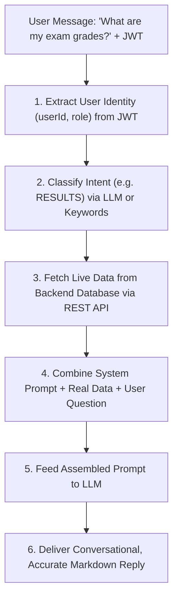

# Full-Stack AI Chatbot Development Roadmap (From Scratch)

This guide provides a complete, beginner-to-advanced roadmap for building an enterprise-ready, context-aware AI chatbot (like **EduCore-Bot**) from scratch. It covers what you need to learn first, how to architect the solution, how to construct the folder structure, and the exact code required for each file.

---

## Table of Contents
1. [Prerequisites: What to Learn First](#1-prerequisites-what-to-learn-first)
2. [High-Level Architectural Pattern (RAG)](#2-high-level-architectural-pattern-rag)
3. [Step 1: Environment Setup](#3-step-1-environment-setup)
4. [Step 2: Designing the Folder Structure](#4-step-2-designing-the-folder-structure)
5. [Step 3: Writing the Backend Code (File-by-File)](#5-step-3-writing-the-backend-code-file-by-file)
6. [Step 4: Writing the Frontend React Component](#6-step-4-writing-the-frontend-react-component)
7. [Step 5: Connecting Frontend, Gateway & Core Backend](#7-step-5-connecting-frontend-gateway--core-backend)
8. [Step 6: Testing & Production Hardening](#8-step-6-testing--production-hardening)

---

## 1. Prerequisites: What to Learn First

Before writing chatbot code, build proficiency in these core concepts:

### A. Python & Web Fundamentals
1. **Python 3.10+ Basics**:
   - Type hinting (`str`, `int`, `Optional[str]`, `list[dict]`).
   - Object-Oriented Programming (Classes, Methods, `__init__`).
   - Exception handling (`try...except...finally`).
2. **FastAPI & Uvicorn**:
   - How routing works (`@app.get()`, `@app.post()`, `APIRouter`).
   - Request and response lifecycle.
   - CORS middleware (Cross-Origin Resource Sharing).
3. **Pydantic**:
   - Data validation with `BaseModel`.
   - Parsing JSON payloads into Python objects and vice-versa.

### B. Generative AI & LLM Fundamentals
1. **LLM Mechanics**:
   - Prompts, tokens, temperature, system messages vs. user messages.
   - API providers (Groq Cloud, OpenAI, Anthropic).
   - Why **Groq**: Provides low-latency inference using LPUs (Language Processing Units).
2. **LangChain & LangChain-Groq**:
   - `ChatGroq`: Wrapper for invoking Groq models.
   - `SystemMessage` & `HumanMessage`.
   - **Structured Outputs** (`.with_structured_output()`): Forcing the LLM to return strict Pydantic objects instead of free-form text.
3. **Prompt Engineering**:
   - System persona definition.
   - Context injection using string templates.
   - Guardrails (preventing off-topic answers and data leaks).

### C. Security & Networking
1. **JSON Web Tokens (JWT)**:
   - Understanding header, payload, and signature.
   - Extracting claims (`userId`, `role`, `email`) to personalize answers.
2. **REST APIs & HTTP Status Codes**:
   - Using Python `requests` or `httpx` to fetch live data from other services.

---

## 2. High-Level Architectural Pattern (RAG)

Do **not** fine-tune an LLM on university data. Instead, use **Retrieval-Augmented Generation (RAG)**:



### Why this works:
- **Zero Hallucinations**: The bot answers only from retrieved database records or verified static FAQs.
- **Privacy & Security**: Users can only see their own attendance/results based on their JWT.
- **Real-Time Accuracy**: If a grade or event changes in the database, the bot reflects it instantly without retraining.

---

## 3. Step 1: Environment Setup

### 1. Initialize Python Environment
```bash
# Create project folder
mkdir university-ai-service
cd university-ai-service

# Create virtual environment
python -m venv venv

# Activate on Windows
.\venv\Scripts\activate

# Or on Mac/Linux:
# source venv/bin/activate
```

### 2. Create `requirements.txt`
```text
fastapi>=0.110.0
uvicorn>=0.28.0
pydantic>=2.6.0
python-dotenv>=1.0.0
langchain>=0.2.0
langchain-core>=0.2.0
langchain-groq>=0.1.0
requests>=2.31.0
pyjwt>=2.8.0
```

Install dependencies:
```bash
pip install -r requirements.txt
```

### 3. Create `.env`
```env
GROQ_API_KEY=gsk_your_actual_groq_api_key_here
MODEL_NAME=openai/gpt-oss-20b
API_GATEWAY_URL=http://localhost:5000/api
```

---

## 4. Step 2: Designing the Folder Structure

Use a modular, production-grade structure that separates concerns:

```
university-ai-service/
│
├── api_client/               # Layer for communicating with other backend services
│   ├── __init__.py
│   └── client.py             # REST calls to Spring Boot / Node API
│
├── config/                   # Central configuration
│   ├── __init__.py
│   └── settings.py           # Loads environment variables
│
├── intents/                  # Intent classification engine
│   ├── __init__.py
│   └── analyzer.py           # Classifies user questions into categories
│
├── models/                   # Pydantic data schemas
│   ├── __init__.py
│   └── schemas.py            # Request, response, and enum definitions
│
├── prompts/                  # Prompt engineering templates
│   ├── __init__.py
│   └── templates.py          # System instructions and personas
│
├── routers/                  # API endpoints
│   ├── __init__.py
│   └── chat.py               # POST /chat route
│
├── services/                 # Core business logic
│   ├── __init__.py
│   └── chat_service.py       # Orchestrates intent -> data retrieval -> LLM response
│
├── utils/                    # Helper utilities
│   ├── __init__.py
│   └── auth.py               # JWT parsing and user extraction
│
├── .env                      # API keys & secrets (git-ignored)
├── main.py                   # FastAPI application entrypoint
└── requirements.txt          # Python dependencies
```

---

## 5. Step 3: Writing the Backend Code (File-by-File)

### 1. `config/settings.py`
Reads and exposes all environment configuration:
```python
import os
from dotenv import load_dotenv

load_dotenv()

API_GATEWAY_URL = os.getenv("API_GATEWAY_URL", "http://localhost:5000/api")
GROQ_API_KEY = os.getenv("GROQ_API_KEY", "")
MODEL_NAME = os.getenv("MODEL_NAME", "openai/gpt-oss-20b")
```

---

### 2. `models/schemas.py`
Defines contracts for request, response, and classification:
```python
from pydantic import BaseModel, Field
from typing import Optional
from enum import Enum

class ChatRequest(BaseModel):
    message: str
    token: Optional[str] = None

class ChatResponse(BaseModel):
    reply: str

class IntentEnum(str, Enum):
    PROFILE = "PROFILE"
    ATTENDANCE = "ATTENDANCE"
    RESULTS = "RESULTS"
    FEES = "FEES"
    EVENTS = "EVENTS"
    SUBJECTS = "SUBJECTS"
    DEPARTMENTS = "DEPARTMENTS"
    SEMESTERS = "SEMESTERS"
    FACULTY = "FACULTY"
    ADMISSIONS = "ADMISSIONS"
    LIBRARY = "LIBRARY"
    CONTACT = "CONTACT"
    CAMPUS = "CAMPUS"
    GENERAL = "GENERAL"

class IntentClassification(BaseModel):
    intent: IntentEnum = Field(description="The classified intent of the user inquiry.")
```

---

### 3. `prompts/templates.py`
Prompts that guide the AI's behavior and guardrails:
```python
INTENT_SYSTEM_PROMPT = """You are an intent classification engine for a University Portal.
Analyze the user message and classify it into EXACTLY ONE intent:
- ADMISSIONS: Questions about applying, admission deadlines, criteria, requirements.
- LIBRARY: Questions about library hours, books, borrowing rules.
- CAMPUS: Questions about facilities, hostels, sports, cafeterias, shuttles.
- CONTACT: Questions about university phone numbers, email, helpdesk.
- DEPARTMENTS: Questions about university academic departments.
- SUBJECTS: Questions about courses, subjects, syllabus.
- EVENTS: Questions about campus workshops, seminars, festivals.
- PROFILE: Questions about user's own profile or account details.
- ATTENDANCE: Questions about student attendance percentage or status.
- RESULTS: Questions about grades, marks, GPA.
- GENERAL: Casual greetings, general questions, or topics not listed above.
"""

GENERATION_SYSTEM_PROMPT = """You are EduCore-Bot, a helpful and professional AI assistant for a University Portal.
Answer the user's question using ONLY the provided context below.

Context Data:
{context}

Guidelines:
1. If the context contains an error (such as 'Please log in'), politely advise the user.
2. Structure answers clearly using markdown bolding and bullet points.
3. Never expose internal database IDs.
4. If asked about non-university topics, politely decline and redirect to campus matters.
"""
```

---

### 4. `utils/auth.py`
Extracts user identity from JWT without requiring local database credentials:
```python
import jwt
import logging

log = logging.getLogger(__name__)

def extract_user_info_from_token(token: str) -> dict:
    if not token:
        return {}
    try:
        if token.startswith("Bearer "):
            token = token[7:]
        payload = jwt.decode(token, options={"verify_signature": False})
        return {
            "userId": payload.get("userId"),
            "role": payload.get("role"),
            "sub": payload.get("sub")
        }
    except Exception as e:
        log.warning(f"Failed to decode token: {e}")
        return {}
```

---

### 5. `api_client/client.py`
Connects the AI service to the core REST API:
```python
import requests
import logging
from typing import Optional
from config.settings import API_GATEWAY_URL

log = logging.getLogger(__name__)

class ApiClient:
    def __init__(self, token: Optional[str] = None):
        self.headers = {"Authorization": f"Bearer {token}"} if token else {}
        self.base_url = API_GATEWAY_URL

    def _get(self, endpoint: str):
        try:
            url = f"{self.base_url}{endpoint}"
            res = requests.get(url, headers=self.headers, timeout=8)
            if res.status_code == 200:
                return res.json()
            elif res.status_code in (401, 403):
                return {"error": "Authentication required. Please log in."}
            return {"error": f"Failed to fetch data (Status {res.status_code})"}
        except Exception as e:
            log.error(f"API request failed for {endpoint}: {e}")
            return {"error": "Service temporarily unavailable."}

    def get_departments(self):
        return self._get("/departments")

    def get_events(self):
        return self._get("/events")

    def get_subjects(self):
        return self._get("/subjects")

    def get_student_profile(self, user_id: int):
        return self._get(f"/students/user/{user_id}")

    def get_attendance(self, student_id: int):
        return self._get(f"/attendance/student/{student_id}")

    def get_results(self, student_id: int):
        return self._get(f"/results/student/{student_id}")
```

---

### 6. `intents/analyzer.py`
Two-tier classification (LLM + instant keyword fallback):
```python
import logging
from config.settings import GROQ_API_KEY, MODEL_NAME
from models.schemas import IntentClassification, IntentEnum
from prompts.templates import INTENT_SYSTEM_PROMPT

log = logging.getLogger(__name__)

class IntentAnalyzer:
    def __init__(self):
        self.llm = None
        if GROQ_API_KEY:
            try:
                from langchain_groq import ChatGroq
                self.llm = ChatGroq(
                    groq_api_key=GROQ_API_KEY,
                    model_name=MODEL_NAME,
                    temperature=0.0,
                    max_tokens=150
                ).with_structured_output(IntentClassification)
            except Exception as e:
                log.error(f"Could not initialize Groq analyzer: {e}")

    def _keyword_intent(self, text: str) -> IntentEnum:
        t = text.lower()
        if any(w in t for w in ["attend", "absent", "presence"]): return IntentEnum.ATTENDANCE
        if any(w in t for w in ["result", "grade", "marks", "gpa"]): return IntentEnum.RESULTS
        if any(w in t for w in ["event", "fest", "seminar"]): return IntentEnum.EVENTS
        if any(w in t for w in ["department", "branch"]): return IntentEnum.DEPARTMENTS
        if any(w in t for w in ["subject", "course"]): return IntentEnum.SUBJECTS
        if any(w in t for w in ["admit", "admission", "apply"]): return IntentEnum.ADMISSIONS
        if any(w in t for w in ["library", "book", "borrow"]): return IntentEnum.LIBRARY
        if any(w in t for w in ["contact", "phone", "email"]): return IntentEnum.CONTACT
        if any(w in t for w in ["campus", "hostel", "canteen"]): return IntentEnum.CAMPUS
        if any(w in t for w in ["profile", "my info", "who am i"]): return IntentEnum.PROFILE
        return IntentEnum.GENERAL

    def analyze_intent(self, msg: str) -> IntentEnum:
        if self.llm:
            try:
                from langchain_core.messages import SystemMessage, HumanMessage
                msgs = [
                    SystemMessage(content=INTENT_SYSTEM_PROMPT),
                    HumanMessage(content=msg)
                ]
                res = self.llm.invoke(msgs)
                return res.intent
            except Exception as e:
                log.warning(f"LLM classification failed: {e}. Falling back to keywords.")
        return self._keyword_intent(msg)
```

---

### 7. `services/chat_service.py`
Coordinates intent identification, data lookup, and final synthesis:
```python
import json
import logging
from config.settings import GROQ_API_KEY, MODEL_NAME
from models.schemas import IntentEnum, ChatRequest, ChatResponse
from intents.analyzer import IntentAnalyzer
from api_client.client import ApiClient
from utils.auth import extract_user_info_from_token
from prompts.templates import GENERATION_SYSTEM_PROMPT

log = logging.getLogger(__name__)

class ChatService:
    def __init__(self):
        self.analyzer = IntentAnalyzer()
        self.llm = None
        if GROQ_API_KEY:
            try:
                from langchain_groq import ChatGroq
                self.llm = ChatGroq(
                    groq_api_key=GROQ_API_KEY,
                    model_name=MODEL_NAME,
                    temperature=0.7,
                    max_tokens=500
                )
            except Exception as e:
                log.error(f"Could not initialize ChatGroq: {e}")

    def process_chat(self, req: ChatRequest) -> ChatResponse:
        user_info = extract_user_info_from_token(req.token)
        uid = user_info.get("userId")
        role = user_info.get("role")

        intent = self.analyzer.analyze_intent(req.message)
        client = ApiClient(req.token)
        ctx = {}

        # 1. Public Institutional Information
        if intent == IntentEnum.ADMISSIONS:
            ctx = {"info": "Admissions are currently open for the Fall semester. Apply online via the admissions portal before August 30. Requirements: high school diploma, minimum GPA 3.0."}
        elif intent == IntentEnum.LIBRARY:
            ctx = {"info": "Central Library hours: Mon-Fri 8AM-10PM, Weekends 10AM-6PM. Students can borrow up to 5 books for 14 days."}
        elif intent == IntentEnum.CONTACT:
            ctx = {"info": "University Helpdesk: support@university.edu | Phone: +1-800-UNIV-HLP"}
        elif intent == IntentEnum.CAMPUS:
            ctx = {"info": "Main Campus features 5 academic blocks, a central library, 3 hostels, an indoor sports complex, and a cafeteria. Shuttles run every 30 minutes."}

        # 2. Live Database Queries
        elif intent == IntentEnum.DEPARTMENTS:
            ctx = client.get_departments()
        elif intent == IntentEnum.EVENTS:
            ctx = client.get_events()
        elif intent == IntentEnum.SUBJECTS:
            ctx = client.get_subjects()

        # 3. Protected User Queries
        elif intent in (IntentEnum.PROFILE, IntentEnum.ATTENDANCE, IntentEnum.RESULTS):
            if not uid:
                ctx = {"error": "Please log in to view your personal academic records."}
            elif intent == IntentEnum.PROFILE:
                ctx = client.get_student_profile(uid)
            elif intent == IntentEnum.ATTENDANCE:
                profile = client.get_student_profile(uid)
                sid = profile.get("studentId") if isinstance(profile, dict) else None
                ctx = client.get_attendance(sid) if sid else {"error": "Student record not found."}
            elif intent == IntentEnum.RESULTS:
                profile = client.get_student_profile(uid)
                sid = profile.get("studentId") if isinstance(profile, dict) else None
                ctx = client.get_results(sid) if sid else {"error": "Student record not found."}
        else:
            ctx = {"note": "General assistance."}

        return self._generate(req.message, intent, ctx)

    def _fallback_reply(self, intent: IntentEnum, ctx: dict) -> str:
        if isinstance(ctx, dict) and "error" in ctx:
            return ctx["error"]
        if "info" in ctx:
            return ctx["info"]
        if intent == IntentEnum.DEPARTMENTS and isinstance(ctx, list):
            return "Departments:\n" + "\n".join([f"- {d.get('deptName', '')} ({d.get('deptCode', '')})" for d in ctx])
        return "Hello! I am EduCore-Bot. How can I assist you with university admissions, departments, or your records?"

    def _generate(self, msg: str, intent: IntentEnum, ctx: dict) -> ChatResponse:
        if self.llm:
            try:
                from langchain_core.messages import SystemMessage, HumanMessage
                prompt = GENERATION_SYSTEM_PROMPT.format(context=json.dumps(ctx, indent=2))
                msgs = [SystemMessage(content=prompt), HumanMessage(content=msg)]
                res = self.llm.invoke(msgs)
                return ChatResponse(reply=res.content.strip())
            except Exception as e:
                log.error(f"LLM generation failed: {e}")

        return ChatResponse(reply=self._fallback_reply(intent, ctx))
```

---

### 8. `routers/chat.py`
Exposes the router:
```python
from fastapi import APIRouter, HTTPException
from models.schemas import ChatRequest, ChatResponse
from services.chat_service import ChatService
import logging

log = logging.getLogger(__name__)
router = APIRouter()
chat_svc = ChatService()

@router.post("/chat", response_model=ChatResponse)
async def chat_endpoint(req: ChatRequest):
    try:
        return chat_svc.process_chat(req)
    except Exception as e:
        log.error(f"Error in chat endpoint: {e}")
        raise HTTPException(status_code=500, detail="Internal server error")
```

---

### 9. `main.py`
Application root:
```python
from fastapi import FastAPI
from fastapi.middleware.cors import CORSMiddleware
from routers import chat

app = FastAPI(title="University AI Microservice")

app.add_middleware(
    CORSMiddleware,
    allow_origins=["*"],
    allow_credentials=True,
    allow_methods=["*"],
    allow_headers=["*"],
)

app.include_router(chat.router, tags=["Chatbot"])

@app.get("/health")
def health_check():
    return {"status": "AI Microservice is up and running!"}

# Run with: python -m uvicorn main:app --host 127.0.0.1 --port 8000
```

---

## 6. Step 4: Writing the Frontend React Component

Create `src/components/common/Chatbot.jsx` in your React project:

```jsx
import React, { useState, useRef, useEffect } from "react";
import axios from "axios";
import { MessageSquare, Send, X, Bot } from "lucide-react";

const Chatbot = () => {
  const [isOpen, setIsOpen] = useState(false);
  const [messages, setMessages] = useState([
    { text: "Hi! I am EduCore-Bot. How can I help you today?", isBot: true }
  ]);
  const [input, setInput] = useState("");
  const [loading, setLoading] = useState(false);
  const messagesEndRef = useRef(null);

  const toggleChat = () => setIsOpen(!isOpen);

  useEffect(() => {
    messagesEndRef.current?.scrollIntoView({ behavior: "smooth" });
  }, [messages]);

  const handleSend = async (e) => {
    e.preventDefault();
    if (!input.trim() || loading) return;

    const userText = input.trim();
    setInput("");
    setMessages((prev) => [...prev, { text: userText, isBot: false }]);
    setLoading(true);

    try {
      const token = sessionStorage.getItem("token") || localStorage.getItem("token");
      const res = await axios.post("/ai/chat", { message: userText, token });
      const reply = res.data?.reply || "I didn't quite catch that.";
      setMessages((prev) => [...prev, { text: reply, isBot: true }]);
    } catch (err) {
      setMessages((prev) => [
        ...prev,
        { text: "Sorry, I am having trouble connecting to the server.", isBot: true }
      ]);
    } finally {
      setLoading(false);
    }
  };

  return (
    <>
      <button
        onClick={toggleChat}
        className="btn btn-primary rounded-circle shadow-lg d-flex justify-content-center align-items-center"
        style={{ position: "fixed", bottom: "24px", right: "24px", width: "56px", height: "56px", zIndex: 1050 }}
      >
        {isOpen ? <X size={22} /> : <MessageSquare size={22} />}
      </button>

      {isOpen && (
        <div
          className="card shadow-lg"
          style={{ position: "fixed", bottom: "90px", right: "24px", width: "360px", height: "480px", zIndex: 1050, display: "flex", flexDirection: "column" }}
        >
          <div className="card-header bg-primary text-white d-flex justify-content-between align-items-center py-2 px-3">
            <div className="d-flex align-items-center gap-2">
              <Bot size={20} />
              <span className="fw-semibold">EduCore AI Assistant</span>
            </div>
            <button onClick={toggleChat} className="btn btn-sm text-white p-0 border-0">
              <X size={18} />
            </button>
          </div>

          <div className="card-body p-3 flex-grow-1" style={{ overflowY: "auto", backgroundColor: "#f8f9fa" }}>
            {messages.map((msg, i) => (
              <div key={i} className={`d-flex mb-2 ${msg.isBot ? "justify-content-start" : "justify-content-end"}`}>
                <div
                  className={`p-2 px-3 rounded-3 shadow-sm ${msg.isBot ? "bg-white text-dark border" : "bg-primary text-white"}`}
                  style={{ maxWidth: "85%", fontSize: "0.88rem", whiteSpace: "pre-line" }}
                >
                  {msg.text}
                </div>
              </div>
            ))}
            {loading && <div className="text-muted small">Thinking...</div>}
            <div ref={messagesEndRef} />
          </div>

          <div className="card-footer bg-white border-top p-2">
            <form onSubmit={handleSend} className="d-flex gap-2">
              <input
                type="text"
                className="form-control form-control-sm rounded-pill px-3"
                placeholder="Ask a question..."
                value={input}
                onChange={(e) => setInput(e.target.value)}
                disabled={loading}
              />
              <button type="submit" className="btn btn-primary btn-sm rounded-circle p-0" style={{ width: "34px", height: "34px" }} disabled={loading || !input.trim()}>
                <Send size={15} />
              </button>
            </form>
          </div>
        </div>
      )}
    </>
  );
};

export default Chatbot;
```

---

## 7. Step 5: Connecting Frontend, Gateway & Core Backend

In your Node.js Express API Gateway (`server.js`), forward requests to port `8000`:

```javascript
// university-api-gateway/server.js
const express = require('express');
const { createProxyMiddleware } = require('http-proxy-middleware');

const app = express();

// Proxy /api to Spring Boot Core Services
app.use('/api', createProxyMiddleware({
    target: 'http://localhost:8080',
    changeOrigin: true
}));

// Proxy /ai to FastAPI Python AI Service
app.use('/ai', createProxyMiddleware({
    target: 'http://localhost:8000',
    changeOrigin: true,
    pathRewrite: { '^/ai': '' },
    on: {
        error: (err, req, res) => {
            if (!res.headersSent) res.status(502).json({ error: 'AI Service unreachable' });
        }
    }
}));

app.listen(5000, () => console.log('API Gateway running on port 5000'));
```

And in React `package.json`:
```json
"proxy": "http://localhost:5000"
```

---

## 8. Step 6: Testing & Production Hardening

### 1. Test via curl / PowerShell
```bash
# Health check
curl http://localhost:8000/health

# Public query
curl -X POST http://localhost:8000/chat \
  -H "Content-Type: application/json" \
  -d '{"message": "When are admissions open?", "token": ""}'

# Authenticated query
curl -X POST http://localhost:8000/chat \
  -H "Content-Type: application/json" \
  -d '{"message": "What is my attendance?", "token": "your_jwt_here"}'
```

### 2. Production Checklist
- **API Key Security**: Keep `.env` out of git (`.gitignore`).
- **Rate Limiting**: Protect the `/chat` route with `express-rate-limit` on the API Gateway to prevent API quota exhaustion.
- **Fail-Safe Fallbacks**: Always provide local keyword fallbacks so the chatbot remains functional even if third-party LLM providers experience outages.
- **Strict Guardrails**: Ensure the system prompt strictly instructs the LLM not to answer questions outside the scope of the institution.
