# University Management System - Database ER Diagram (university_db)

This document contains the complete **Entity-Relationship (ER) Diagram** and detailed schema documentation for all 13 tables in the MySQL `university_db` database.

---

## 1. Visual Entity-Relationship (ER) Diagram

```mermaid
erDiagram
    USERS ||--o| STUDENTS : "1:1 profile (user_id)"
    USERS ||--o| FACULTY : "1:1 profile (user_id)"

    DEPARTMENTS ||--o{ STUDENTS : "belongs to (dept_id)"
    DEPARTMENTS ||--o{ FACULTY : "employs (dept_id)"
    DEPARTMENTS |o--o| FACULTY : "headed by HOD (hod_id)"
    DEPARTMENTS ||--o{ SUBJECTS : "offers (dept_id)"

    SEMESTERS ||--o{ SUBJECTS : "contains (semester_id)"
    SEMESTERS ||--o{ ENROLLMENTS : "schedules (semester_id)"
    SEMESTERS ||--o{ ATTENDANCE : "tracks (semester_id)"
    SEMESTERS ||--o{ RESULTS : "grades (semester_id)"
    SEMESTERS ||--o{ FEES : "bills (semester_id)"
    SEMESTERS ||--o{ COURSE_ASSIGNMENTS : "assigns (semester_id)"

    STUDENTS ||--o{ ENROLLMENTS : "enrolls (student_id)"
    STUDENTS ||--o{ ATTENDANCE : "has attendance (student_id)"
    STUDENTS ||--o{ RESULTS : "receives (student_id)"
    STUDENTS ||--o{ FEES : "incurs (student_id)"

    FACULTY ||--o{ ATTENDANCE : "marks (faculty_id)"
    FACULTY ||--o{ COURSE_ASSIGNMENTS : "teaches (faculty_id)"
    FACULTY ||--o{ EVENTS : "organizes (organizer_id)"

    SUBJECTS ||--o{ ENROLLMENTS : "subject (subject_id)"
    SUBJECTS ||--o{ ATTENDANCE : "subject (subject_id)"
    SUBJECTS ||--o{ RESULTS : "subject (subject_id)"
    SUBJECTS ||--o{ EXAMS : "tests (subject_id)"
    SUBJECTS ||--o{ COURSE_ASSIGNMENTS : "assigned to (subject_id)"

    USERS {
        bigint id PK
        varchar username UK
        varchar email UK
        varchar password
        enum role "ADMIN, FACULTY, STUDENT"
        varchar profile_image
        date created_on
        datetime last_updated
    }

    DEPARTMENTS {
        bigint id PK
        varchar dept_code UK
        varchar dept_name UK
        bigint hod_id FK
        date created_on
        datetime last_updated
    }

    SEMESTERS {
        bigint id PK
        varchar semester_name
        int year
        date start_date
        date end_date
        date created_on
        datetime last_updated
    }

    STUDENTS {
        bigint id PK
        varchar enrollment_no UK
        varchar full_name
        date date_of_birth
        int current_semester
        bigint dept_id FK
        bigint user_id FK "UK"
        date created_on
        datetime last_updated
    }

    FACULTY {
        bigint id PK
        varchar full_name
        varchar qualification
        bigint dept_id FK
        bigint user_id FK "UK"
        date created_on
        datetime last_updated
    }

    SUBJECTS {
        bigint id PK
        varchar subject_code UK
        varchar subject_name
        int credits
        varchar syllabus_path
        bigint dept_id FK
        bigint semester_id FK
        date created_on
        datetime last_updated
    }

    ATTENDANCE {
        bigint id PK
        date attendance_date
        enum status "PRESENT, ABSENT"
        bigint student_id FK
        bigint subject_id FK
        bigint semester_id FK
        bigint faculty_id FK
        date created_on
        datetime last_updated
    }

    RESULTS {
        bigint id PK
        int theory_marks
        int practical_marks
        int total_marks
        varchar grade
        date result_date
        bigint student_id FK
        bigint subject_id FK
        bigint semester_id FK
        date created_on
        datetime last_updated
    }

    FEES {
        bigint id PK
        double amount
        date due_date
        date payment_date
        varchar academic_year
        enum status "PAID, PARTIAL, PENDING"
        bigint student_id FK
        bigint semester_id FK
        date created_on
        datetime last_updated
    }

    ENROLLMENTS {
        bigint id PK
        varchar academic_year
        bigint student_id FK
        bigint semester_id FK
        bigint subject_id FK
        date created_on
        datetime last_updated
    }

    COURSE_ASSIGNMENTS {
        bigint id PK
        varchar academic_year
        bigint faculty_id FK
        bigint subject_id FK
        bigint semester_id FK
        date created_on
        datetime last_updated
    }

    EXAMS {
        bigint id PK
        varchar exam_name
        date exam_date
        int max_marks
        bigint subject_id FK
        date created_on
        datetime last_updated
    }

    EVENTS {
        bigint id PK
        varchar title
        varchar description
        date event_date
        varchar venue
        enum type "EVENT, NEWS, SYLLABUS"
        varchar file_path
        bigint organizer_id FK
        date created_on
        datetime last_updated
    }
```

---

## 2. Table-by-Table Schema Breakdown

### 1. `users` (Core Authentication)
Stores system login credentials and role assignment.
- `id` (BIGINT, PK, Auto Increment)
- `username` (VARCHAR(255), Unique, Not Null)
- `email` (VARCHAR(255), Unique, Not Null)
- `password` (VARCHAR(255), BCrypt Hashed, Not Null)
- `role` (ENUM: `'ADMIN'`, `'FACULTY'`, `'STUDENT'`, Not Null)
- `profile_image` (VARCHAR(255), Nullable)
- `created_on` (DATE), `last_updated` (DATETIME)

### 2. `departments` (Academic Units)
- `id` (BIGINT, PK)
- `dept_code` (VARCHAR(255), Unique, Not Null, e.g. `'CS'`, `'ME'`)
- `dept_name` (VARCHAR(255), Unique, Not Null, e.g. `'Computer Science'`)
- `hod_id` (BIGINT, FK -> `faculty.id`, Nullable)

### 3. `semesters` (Academic Terms)
- `id` (BIGINT, PK)
- `semester_name` (VARCHAR(255), Not Null, e.g. `'Semester 1'`)
- `year` (INT)
- `start_date` (DATE), `end_date` (DATE)

### 4. `faculty` (Professors & Instructors)
- `id` (BIGINT, PK)
- `full_name` (VARCHAR(255), Not Null)
- `qualification` (VARCHAR(255))
- `dept_id` (BIGINT, FK -> `departments.id`, Not Null)
- `user_id` (BIGINT, Unique, FK -> `users.id`, Nullable)

### 5. `students` (Student Profiles)
- `id` (BIGINT, PK)
- `enrollment_no` (VARCHAR(255), Unique, Not Null)
- `full_name` (VARCHAR(255), Not Null)
- `date_of_birth` (DATE)
- `current_semester` (INT)
- `dept_id` (BIGINT, FK -> `departments.id`, Not Null)
- `user_id` (BIGINT, Unique, FK -> `users.id`, Nullable)

### 6. `subjects` (Curriculum Courses)
- `id` (BIGINT, PK)
- `subject_code` (VARCHAR(255), Unique, Not Null)
- `subject_name` (VARCHAR(255), Not Null)
- `credits` (INT)
- `syllabus_path` (VARCHAR(255))
- `dept_id` (BIGINT, FK -> `departments.id`, Not Null)
- `semester_id` (BIGINT, FK -> `semesters.id`, Not Null)

### 7. `attendance` (Daily Class Records)
- `id` (BIGINT, PK)
- `attendance_date` (DATE, Not Null)
- `status` (ENUM: `'PRESENT'`, `'ABSENT'`, Not Null)
- `student_id` (BIGINT, FK -> `students.id`, Not Null)
- `subject_id` (BIGINT, FK -> `subjects.id`, Not Null)
- `semester_id` (BIGINT, FK -> `semesters.id`, Not Null)
- `faculty_id` (BIGINT, FK -> `faculty.id`, Not Null)

### 8. `results` (Grades & Transcripts)
- `id` (BIGINT, PK)
- `theory_marks` (INT), `practical_marks` (INT), `total_marks` (INT)
- `grade` (VARCHAR(255), e.g. `'A+'`, `'B'`)
- `result_date` (DATE)
- `student_id` (BIGINT, FK -> `students.id`, Not Null)
- `subject_id` (BIGINT, FK -> `subjects.id`, Not Null)
- `semester_id` (BIGINT, FK -> `semesters.id`, Not Null)

### 9. `fees` (Tuition & Invoicing)
- `id` (BIGINT, PK)
- `amount` (DOUBLE, Not Null)
- `due_date` (DATE, Not Null)
- `payment_date` (DATE, Nullable)
- `academic_year` (VARCHAR(255), Not Null)
- `status` (ENUM: `'PAID'`, `'PARTIAL'`, `'PENDING'`, Not Null)
- `student_id` (BIGINT, FK -> `students.id`, Not Null)
- `semester_id` (BIGINT, FK -> `semesters.id`, Not Null)

### 10. `enrollments` (Student-Subject Mapping)
- `id` (BIGINT, PK)
- `academic_year` (VARCHAR(255), Not Null)
- `student_id` (BIGINT, FK -> `students.id`, Not Null)
- `semester_id` (BIGINT, FK -> `semesters.id`, Not Null)
- `subject_id` (BIGINT, FK -> `subjects.id`, Not Null)

### 11. `course_assignments` (Faculty-Subject Teaching Allocation)
- `id` (BIGINT, PK)
- `academic_year` (VARCHAR(255), Not Null)
- `faculty_id` (BIGINT, FK -> `faculty.id`, Not Null)
- `subject_id` (BIGINT, FK -> `subjects.id`, Not Null)
- `semester_id` (BIGINT, FK -> `semesters.id`, Not Null)

### 12. `exams` (Examination Schedules)
- `id` (BIGINT, PK)
- `exam_name` (VARCHAR(255), Not Null)
- `exam_date` (DATE, Not Null)
- `max_marks` (INT, Not Null)
- `subject_id` (BIGINT, FK -> `subjects.id`, Not Null)

### 13. `events` (Campus Notices, Events & Syllabuses)
- `id` (BIGINT, PK)
- `title` (VARCHAR(255), Not Null)
- `description` (VARCHAR(1000))
- `event_date` (DATE)
- `venue` (VARCHAR(255))
- `type` (ENUM: `'EVENT'`, `'NEWS'`, `'SYLLABUS'`, Not Null)
- `file_path` (VARCHAR(255))
- `organizer_id` (BIGINT, FK -> `faculty.id`, Not Null)
