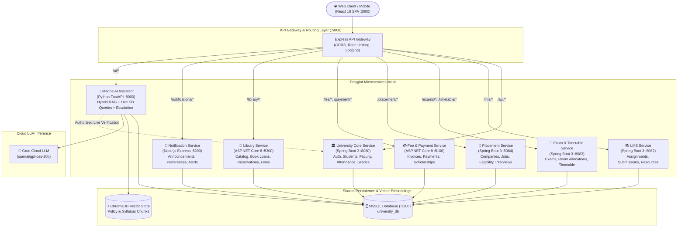

# 🎓 EduCore University ERP — Enterprise Microservices Ecosystem

[](https://spring.io/projects/spring-boot)
[](https://dotnet.microsoft.com/)
[](https://fastapi.tiangolo.com/)
[](https://react.dev/)
[](https://nodejs.org/)
[](https://www.mysql.com/)
[](LICENSE)

An end-to-end, enterprise-grade University Management & Campus Enterprise Resource Planning (ERP) platform built with a polyglot microservices architecture. EduCore delivers a unified digital campus experience spanning academic lifecycle management, assignments (LMS), examinations, campus placements, fee processing, library circulation, multi-channel notifications, and an intelligent **Medha AI Student Assistant** powered by Retrieval-Augmented Generation (RAG).

---

## 🏛️ System Architecture Overview

EduCore is structured as a resilient, decoupled microservices mesh. All client requests flow through a unified **Node.js Express API Gateway** that handles CORS, rate limiting, access routing, and proxying to backend microservices.



---

## 📦 Microservices Portfolio & Tech Stack

| Microservice | Directory | Technology | Port | Responsibilities |
| :--- | :--- | :--- | :---: | :--- |
| **API Gateway** | `university-api-gateway` | Node.js, Express, `http-proxy-middleware` | `5000` | Unified reverse proxy, rate limiting, request logging, route aggregation. |
| **University Core** | `university-service` | Java 17, Spring Boot 3, Spring Security, JPA | `8080` | JWT Authentication, RBAC, User/Student/Faculty profiles, Attendance, Results & Grading. |
| **LMS** | `university-lms-service` | Java 17, Spring Boot 3, Hibernate | `8082` | Course assignments, student submissions, file uploads, study resources repository. |
| **Exam & Timetable** | `university-exam-service` | Java 17, Spring Boot 3, JPA | `8083` | Exam schedules, hall tickets, classroom seating allocations, conflict-free weekly timetable. |
| **Placement & Career** | `university-placement-service` | Java 17, Spring Boot 3, JPA | `8084` | Recruiter companies, job openings, academic CGPA eligibility checks, interviews, student skills. |
| **Fee & Payment** | `university-fee-service` | C#, ASP.NET Core 8 Web API, Pomelo MySQL | `5100` | Student fee balances, invoice calculation, payment processing mock, scholarship waivers. |
| **Library Management** | `university-library-service` | C#, ASP.NET Core 8 Web API, Pomelo MySQL | `5300` | Physical books catalog, accession copies (`book_copies`), book loans, reservations, overdue fines. |
| **Notifications** | `university-notification-service` | Node.js, Express, MySQL2, Node-Cron | `5200` | Real-time campus broadcasts, student alert notifications, unread badges, user preferences. |
| **Medha AI Assistant** | `university-ai-service` | Python 3.11, FastAPI, ChromaDB, Groq LLM | `8000` | Hybrid RAG on university documents, verified live attendance/grade lookups, escalation ticketing. |
| **Web Frontend** | `university-frontend/university-frontend` | React 18, Bootstrap 5, Lucide Icons, Axios | `3000` | Unified responsive Single Page Application with dedicated Admin, Faculty, and Student portals. |

---

## ✨ Key Feature Highlights

### 1. 🏛️ Core Academic Lifecycle & RBAC
- **Multi-Role Security:** Granular access controls for `ADMIN`, `FACULTY`, and `STUDENT` roles enforced via signed HMAC-SHA JWT tokens.
- **Attendance & Grading Engine:** Real-time tracking of lecture attendance percentages and automated grade-point calculation (GPA & CGPA).
- **Course & Faculty Assignment:** Administrators can assign professors to specific subject courses and schedule lecture halls dynamically.

### 2. 📚 Learning Management System (LMS)
- **Assignments Workflow:** Faculty members publish homework tasks with strict submission deadlines; students upload text and project links.
- **Study Resources Hub:** Centralized digital library for lecture notes, reference PDFs, and syllabus guides.

### 3. 📝 Examination & Smart Timetable
- **Automated Hall Tickets:** Generates digital examination passes displaying roll number, subject codes, and assigned examination rooms.
- **Timetable Scheduling:** Weekly recurring lecture timetable with conflict-free period assignments across departments.

### 4. 💼 Campus Placements & Career Portal
- **Job Openings with Automated Eligibility Filtering:** Students can view active openings with eligibility rules automatically checking CGPA thresholds and allowable branches.
- **One-Click Application:** Track status through `APPLIED`, `SHORTLISTED`, `INTERVIEW_SCHEDULED`, `SELECTED`, or `REJECTED`.
- **Skills Portfolio:** Students maintain their verified programming languages, tools, and technical proficiencies for campus recruiters.

### 5. 💳 Fees, Invoices & Scholarships (ASP.NET Core)
- **Automated Invoicing:** Calculates tuition, examination, and hostel fees per semester.
- **Payment Gateway Simulation:** Mock payment handling with unique reference numbers and instant receipt generation.
- **Merit Scholarships:** Students apply for financial assistance; administrators evaluate and apply instant percentage waivers.

### 6. 📖 Library Circulation & Fine Management (ASP.NET Core)
- **Book Copies Inventory:** Distinguishes between book titles and physical accession copies (`book_copies`).
- **Circulation Lifecycle:** Issue and return management with automated overdue tracking at ₹5/day after due date.
- **Reservation Queue:** Students can reserve currently borrowed copies to ensure next-in-line access upon return.

### 7. 🤖 Medha AI Student Assistant (Hybrid RAG + Live APIs)
- **Verified Policy & Syllabus Retrieval:** Answers queries regarding university guidelines, fee refund policies, and exam rules using ChromaDB vector search with exact document citations.
- **Authorized Student Data Access:** When asking about attendance or grades (*"What is my current CGPA?"*), Medha verifies the user's JWT through Spring Boot backend APIs to guarantee students only see their own private academic records.
- **Support Escalation Ticketing:** When an inquiry requires human intervention, Medha automatically generates a support ticket assigned to university staff.

---

## 🚀 Quick Start Guide

### Prerequisites
Before running the system, ensure your machine has the following tools installed:
- **Java Development Kit (JDK 17+)** & Maven
- **Node.js (v18+)** & npm
- **.NET 8.0 SDK**
- **Python (v3.10 or v3.11)**
- **MySQL Server (v8.0 or v9.0)** running on port `3306`

---

### Step 1: Database Setup
1. Launch MySQL and create the database:
   ```sql
   CREATE DATABASE university_db CHARACTER SET utf8mb4 COLLATE utf8mb4_unicode_ci;
   ```
2. The Spring Boot, ASP.NET Core, and Python microservices will automatically generate required tables via Hibernate DDL and initial database seeders on their first run.

---

### Step 2: Environment Configuration
Copy each service's example configuration file and adjust credentials if needed:

```bash
# 1. AI Service
copy university-ai-service\.env.example university-ai-service\.env

# 2. Notification Service
copy university-notification-service\.env.example university-notification-service\.env

# 3. API Gateway
copy university-api-gateway\.env.example university-api-gateway\.env
```

> [!NOTE]
> If you have a [Groq API Key](https://console.groq.com/), place it into `university-ai-service/.env` under `GROQ_API_KEY`. If left empty, Medha AI will gracefully fall back to local rule-based student assistance.

---

### Step 3: One-Click Startup (Windows)

EduCore includes pre-configured automation scripts that launch all 10 microservices and the frontend in parallel:

```cmd
# Double-click or run from command prompt:
START_PROJECT.bat
```

To gracefully stop all background services and free up system ports:
```cmd
STOP_PROJECT.bat
```

*For PowerShell users:*
```powershell
.\scripts\start-all.ps1
# To stop:
.\scripts\stop-all.ps1
```

---

### Step 4: Accessing the Application

Open your browser and navigate to:
👉 **`http://localhost:3000`**

#### 🔑 Pre-Seeded Default Accounts

| Role | Username | Email | Password | Access Capabilities |
| :--- | :--- | :--- | :--- | :--- |
| **Admin** | `superadmin` | `superadmin@university.edu` | `admin@123` | Full administrative control, faculty assigning, fees, catalog, placement officer controls |
| **Faculty** | `test_faculty` | `faculty@university.edu` | `faculty@123` | Mark attendance, grade assignments, submit exam results, view course timetable |
| **Student** | `test_student` | `student@university.edu` | `student@123` | View attendance, check results, pay fees, borrow library books, apply for campus placements, chat with Medha AI |

---

## 🛠️ Manual Step-by-Step Execution

If you prefer launching microservices individually in separate terminals:

<details>
<summary><b>Click to expand manual startup commands</b></summary>

#### 1. Core University Service (Java / Port 8080)
```bash
cd university-service
mvn spring-boot:run
```

#### 2. LMS Service (Java / Port 8082)
```bash
cd university-lms-service
mvn spring-boot:run
```

#### 3. Exam & Timetable Service (Java / Port 8083)
```bash
cd university-exam-service
mvn spring-boot:run
```

#### 4. Placement & Career Service (Java / Port 8084)
```bash
cd university-placement-service
mvn spring-boot:run
```

#### 5. Fee & Payment Service (.NET Core / Port 5100)
```bash
cd university-fee-service
dotnet run
```

#### 6. Library Service (.NET Core / Port 5300)
```bash
cd university-library-service
dotnet run
```

#### 7. Notification Service (Node.js / Port 5200)
```bash
cd university-notification-service
npm install
npm start
```

#### 8. Medha AI Assistant (Python / Port 8000)
```bash
cd university-ai-service
python -m venv venv
.\venv\Scripts\activate
pip install -r requirements.txt
uvicorn main:app --host 0.0.0.0 --port 8000 --reload
```

#### 9. API Gateway (Node.js / Port 5000)
```bash
cd university-api-gateway
npm install
node server.js
```

#### 10. React Frontend (React / Port 3000)
```bash
cd university-frontend/university-frontend
npm install
npm start
```

</details>

---

## 📂 Project Repository Structure

```
d:\New Project
├── .gitignore                          # Master Git exclusion rules (Secrets, DB dumps, builds)
├── START_PROJECT.bat                   # 1-click startup automation batch script
├── STOP_PROJECT.bat                    # 1-click port cleanup and shutdown script
├── AI_ARCHITECTURE.md                  # Detailed Medha AI RAG architecture & data flow
├── DATABASE_ERD.md                     # Comprehensive database schema & table relationships
│
├── university-api-gateway/             # Central Node.js API Gateway (Port 5000)
│   ├── server.js                       # Route proxying, rate limiting, and CORS
│   └── .env.example                    # Gateway environment configuration template
│
├── university-service/                 # Core Spring Boot Microservice (Port 8080)
│   ├── src/main/java/com/university/   # Auth, Students, Faculty, Attendance, Results
│   └── src/main/resources/             # application.properties & SQL schemas
│
├── university-lms-service/             # Spring Boot LMS Service (Port 8082)
│   └── src/main/java/com/university/lms/ # Assignments, Submissions, Resources
│
├── university-exam-service/            # Spring Boot Exam & Timetable Service (Port 8083)
│   └── src/main/java/com/university/exam/ # Exam schedules, Seating, Timetable
│
├── university-placement-service/       # Spring Boot Placement & Career Service (Port 8084)
│   └── src/main/java/com/university/placement/ # Job Openings, Applications, Interviews, Skills
│
├── university-fee-service/             # ASP.NET Core Fee & Payment Microservice (Port 5100)
│   ├── Controllers/                    # Fees, Payments, and Scholarships endpoints
│   └── Program.cs                      # ASP.NET Core dependency injection & MySQL context
│
├── university-library-service/         # ASP.NET Core Library Microservice (Port 5300)
│   ├── Controllers/                    # Books, Copies, Loans, Reservations, Fines
│   └── Program.cs                      # ASP.NET Core configuration & CORS
│
├── university-notification-service/    # Node.js Express Notification Microservice (Port 5200)
│   ├── server.js                       # Announcements, notification alerts, cron triggers
│   └── .env.example                    # DB connection & JWT secret template
│
├── university-ai-service/              # Python FastAPI Medha AI Student Assistant (Port 8000)
│   ├── main.py                         # FastAPI application entrypoint
│   ├── services/                       # RAG service, Vector store, Assistant orchestrator
│   ├── api_client/                     # Secure live student data HTTP client
│   └── .env.example                    # Groq API key & configuration template
│
└── university-frontend/
    └── university-frontend/            # React 18 Single Page Application (Port 3000)
        ├── src/pages/admin/            # Admin Dashboards (Faculty, Exams, Library, Placements)
        ├── src/pages/faculty/          # Faculty Portals (Assignments, Attendance, Timetable)
        ├── src/pages/student/          # Student Portals (Grades, Library, Fees, Placements)
        └── src/components/common/      # Medha AI Chatbot widget, layout shells, modals
```

---

## 🔒 Security & Git Best Practices

The repository is configured with enterprise-grade repository sanitization:
- **Zero Committed Secrets:** All `.env`, `*.pem`, `*.key`, `*.pfx`, and `jwt-secret.txt` files are strictly excluded across every microservice directory.
- **Database Privacy:** Raw `*.sql`, `*.dump`, and `*.db` files are blocked from being committed to protect student privacy and test credentials.
- **Build Isolation:** All heavy build artifacts (`target/`, `bin/`, `obj/`, `node_modules/`, `venv/`, and `build/`) are untracked and ignored.
- **Sample Configuration:** Each microservice provides an `.env.example` template with dummy placeholders to enable safe developer onboarding.

---

## 🤝 Contributing

Contributions to the EduCore ERP platform are welcome! Follow these steps to submit improvements:
1. Fork the Project repository.
2. Create your Feature Branch (`git checkout -b feature/NewCapability`).
3. Commit your changes (`git commit -m 'Add support for online payment webhooks'`).
4. Push to the Branch (`git push origin feature/NewCapability`).
5. Open a Pull Request.

---

## 📄 License

This project is licensed under the [MIT License](LICENSE) — free to use and modify for educational, academic, and commercial purposes.
